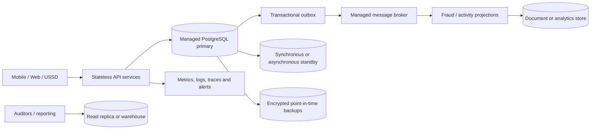

# Portfolio 5 — Distributed and Cloud Database Exercise

## Project context

This exercise sketches a safe cloud-style architecture for the simulated PayBridge database. It focuses on availability, replication, backup/recovery, regional placement, and operational trade-offs. It is a design exercise only: it does not provision cloud resources, contain credentials, or claim a production-ready banking deployment.

## 1. Reference architecture

Keep the authoritative financial write path in one strongly consistent PostgreSQL primary per write domain. Use replicas for read workloads that can tolerate replication lag. The message broker and document/analytics stores are projections, not sources of truth for balances.

## 2. Data placement and consistency

- **Primary:** customer account changes and all ledger postings. Use transactions and unique idempotency keys.
- **Standby:** high availability/failover. Understand synchronous vs. asynchronous replication latency and potential recovery-point exposure.
- **Read replica:** statements or reporting only when replica lag is acceptable; include freshness metadata or route sensitive reads to primary.
- **Event consumers:** at-least-once delivery with deduplication; use outbox rows committed atomically with business changes.
- **Object storage/warehouse:** encrypted backups and minimized analytical extracts with separate access controls.

Do not independently accept writes for the same account in multiple regions without a conflict-free business design. Financial account balances and unique idempotency semantics require deliberate consistency guarantees.

## 3. Availability and recovery objectives

Define service-level objectives before choosing an architecture:

- **RPO (recovery point objective):** maximum acceptable committed-data loss.
- **RTO (recovery time objective):** target time to restore service.
- **Read freshness:** maximum acceptable replication delay for each read class.
- **Failover policy:** who approves/promotes a standby, how clients rediscover the endpoint, and how split-brain is prevented.

Backups are not verified until restore tests succeed. Test point-in-time recovery to an isolated environment, verify row/journal counts and ledger reconciliation, then document measured recovery time. Retain backup encryption keys separately under controlled recovery procedures.

## 4. Security and operations

- Store cloud credentials outside source control, using managed identity or a secrets manager.
- Use TLS, private networking, least-privilege database roles, and rotation of credentials/keys.
- Enable encryption at rest and protect backup/export access.
- Monitor connection saturation, CPU, I/O, storage growth, lock waits, deadlocks, replication lag, failed backups, and reconciliation.
- Use connection pooling sized to database limits and monitor pool wait time.
- Apply schema migrations through reviewed, versioned deployment steps; avoid risky long locks during peak traffic.
- Maintain incident, failover, backup restore, and regional recovery runbooks.
- Keep customer/financial data out of development and portfolio environments; this project uses synthetic records.

## 5. Distributed-systems failure cases

| Failure | Expected handling |
|---|---|
| API times out after database commit | Client retries with same idempotency key; service returns existing outcome |
| Broker unavailable | Outbox intent remains durable; publisher retries without losing the committed ledger transaction |
| Consumer receives event twice | Deduplicate using stable event ID and idempotent projection upsert |
| Read replica is behind | Route balance-critical reads to primary or disclose freshness; do not make a stale decision silently |
| Primary fails during commit | Resolve transaction outcome by idempotency key before retrying external effects |
| Regional network partition | Avoid competing financial writes; fail closed or use explicitly defined degraded behavior |
| Backup restore | Restore to isolated target, validate integrity, reconcile journals, then perform controlled cutover |

## 6. Practical tabletop / local exercise

No cloud account is required. Use a disposable local PostgreSQL instance and a second database or mock consumer:

1. Load the synthetic schema and seed dataset.
2. Record baseline account and ledger counts plus `balance_audit` exceptions.
3. Simulate a delayed event consumer; verify the authoritative transaction remains committed while the projection lags.
4. Deliver one synthetic event twice and verify idempotent processing.
5. Take a logical backup, restore it into a fresh database, and compare counts and reconciliation results.
6. Simulate an unavailable read projection and describe which operations remain safe on the primary.
7. Write a short runbook with restore steps, role assignments, validation queries, and measured RTO/RPO for the local exercise.

## 7. Cloud deployment decision checklist

Before selecting managed database services, document: region/data residency needs; target RPO/RTO; expected connection and transaction rates; read/write split; failover behavior; encryption and key ownership; audit requirements; backup retention; restore test cadence; cost limits; provider exit strategy; and operational ownership. Validate all settings against current cloud-provider documentation and organizational compliance requirements.

This portfolio is an architecture and reliability exercise, not evidence that a cloud deployment has been executed or certified.
